# Lab 01 - Microsoft Entra ID User & Group Management

## 1. Overview

For this lab, I used Microsoft Entra ID to practice creating and managing users and security groups in a cloud environment.

The main goal was to create 10 employee accounts using a CSV file, assign them to different departments, and configure security groups to organize the users.

I also worked with dynamic security groups to see how Entra ID can automatically add users to groups based on their department information instead of having to manage everything manually.

## 2. Business Scenario

For this project, I used a fictional company called Copper Creek.

The company has 10 new employees joining three different departments: IT, HR, and Finance.

Instead of creating every employee account individually, I wanted to see how an IAM administrator could create multiple accounts at once and organize them into security groups.

I also wanted to compare manually assigning users to groups with using dynamic groups that automatically update membership based on user attributes.

This is useful in a real organization because employees are constantly being hired, changing departments, or leaving the company.

## 3. Objectives

The goals for this lab were to:

- Create 10 employee accounts using a CSV bulk upload.
- Assign department attributes to the employees.
- Create security groups for IT, HR, and Finance.
- Manually add employees to their assigned security groups.
- Create dynamic security groups for each department.
- Configure dynamic membership rules.
- Verify that users are being added to the correct groups.
- Get more hands-on experience managing identities in Entra ID.

## 4. Technologies Used

- Microsoft Entra ID
- Microsoft Entra Admin Center
- Microsoft Excel
- CSV Bulk User Import
- Security Groups
- Dynamic Membership Rules

## 5. Implementation

### Step 1 - Bulk Creating Users

I started by downloading the bulk user creation CSV template from Microsoft Entra ID.

I opened the template in Excel and entered information for 10 fictional employees.

The CSV included each employee's name, username, initial password, and account status.

After completing the template, I saved it as a CSV file and uploaded it through the bulk create option in Entra ID.

Once the accounts were created, I checked the All Users page to make sure they appeared.

I was able to verify that all 10 employee accounts were present, along with my existing administrator account.

**Screenshot - CSV File**

**Screenshot - Created Users**

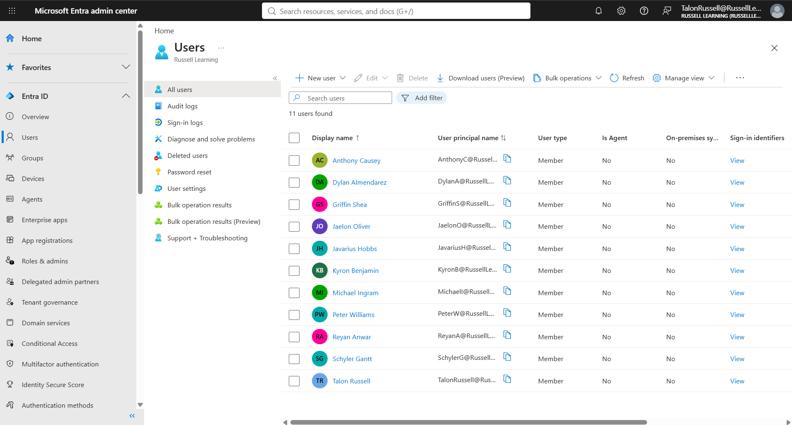

### Step 2 - Configuring Departments

Next, I assigned department attributes to the employees.

I used three departments for this lab:

- IT
- HR
- Finance

To do this, I opened each user's properties in Entra ID and updated their department under Job Information.

This was important because the dynamic security groups I created later would use these department values to determine which users should be members.

### Step 3 - Creating Security Groups

After configuring the employees, I created three security groups.

| Group Name | Membership Type |
|---|---|
| SG-IT | Assigned |
| SG-HR | Assigned |
| SG-FINANCE | Assigned |

I created these groups by going to Entra ID > Groups > All Groups > New Group.

I selected Security as the group type and Assigned as the membership type.

After creating the groups, I manually added employees based on their departments.

The groups ended up with the following memberships:

| Group | Members |
|---|---|
| SG-IT | Griffin Shea, Kyron Benjamin, Reyan Anwar |
| SG-HR | Anthony Causey, Jaelon Oliver, Michael Ingram, Schyler Gantt |
| SG-FINANCE | Dylan Almendarez, Javarius Hobbs, Peter Williams |

This helped me understand how an administrator can organize users and manually control group membership.

**Screenshot - Created Security Groups**

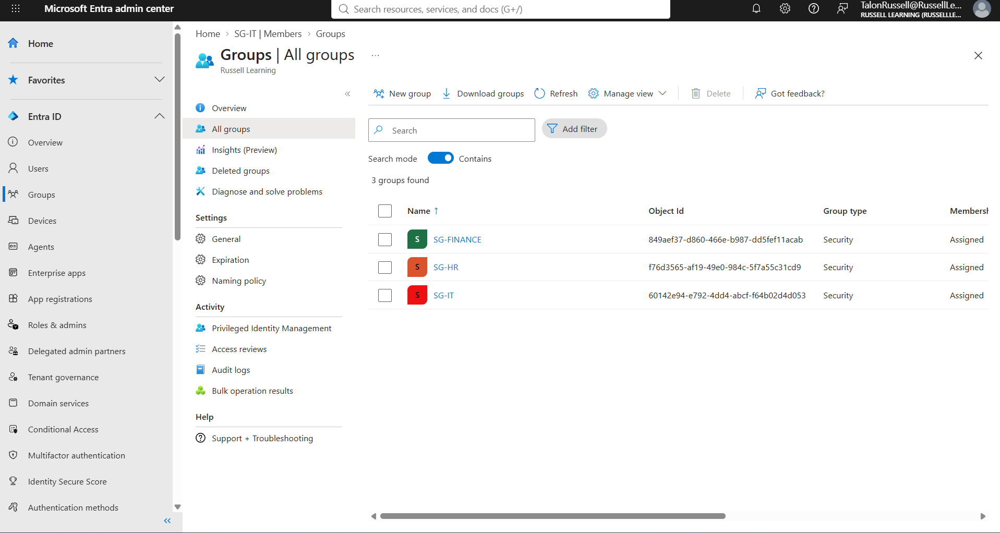

**Screenshot - IT Group Members**

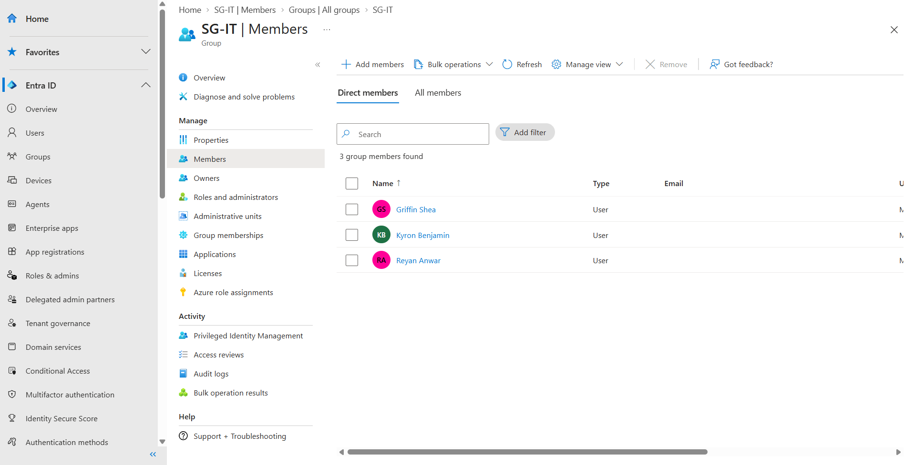

**Screenshot - HR Group Members**

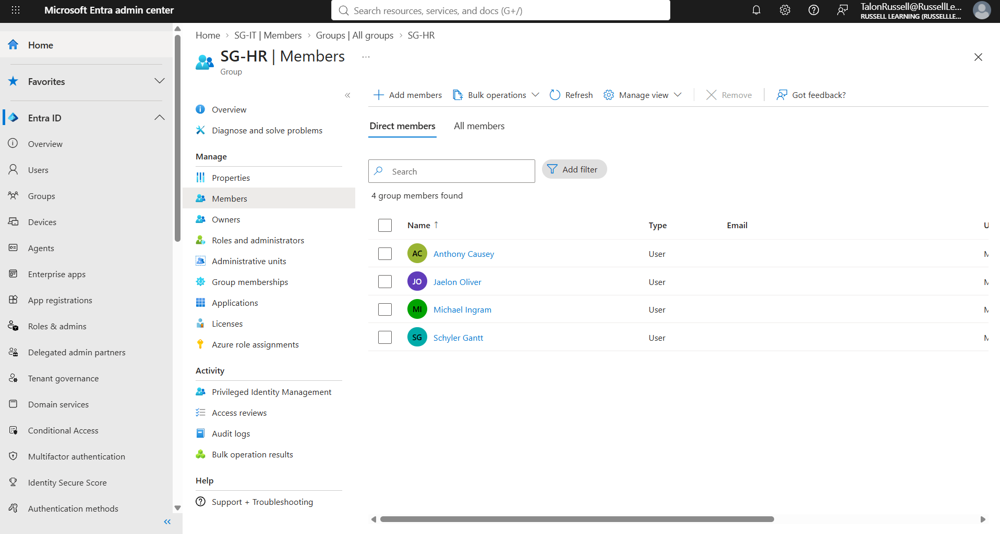

**Screenshot - Finance Group Members**

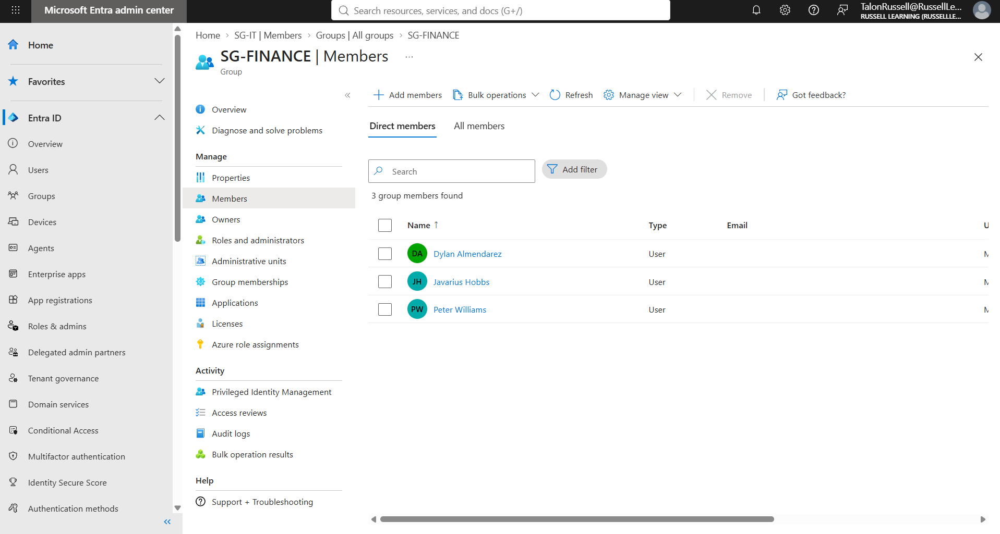

### Step 4 - Creating Dynamic Security Groups

After creating the assigned security groups, I wanted to see how I could automate the process.

I created three additional security groups using Dynamic User as the membership type.

The groups were:

- DYN-IT
- DYN-HR
- DYN-FINANCE

For each group, I configured a membership rule using the user's department attribute.

**IT Rule:**

    user.department -eq "IT"

**HR Rule:**

    user.department -eq "HR"

**Finance Rule:**

    user.department -eq "Finance"

These rules tell Entra ID to automatically include users whose department matches the rule.

For example, any user with their department set to IT should automatically become a member of DYN-IT.

This eliminates the need to manually add users to these groups.

**Screenshot - IT Dynamic Rule**

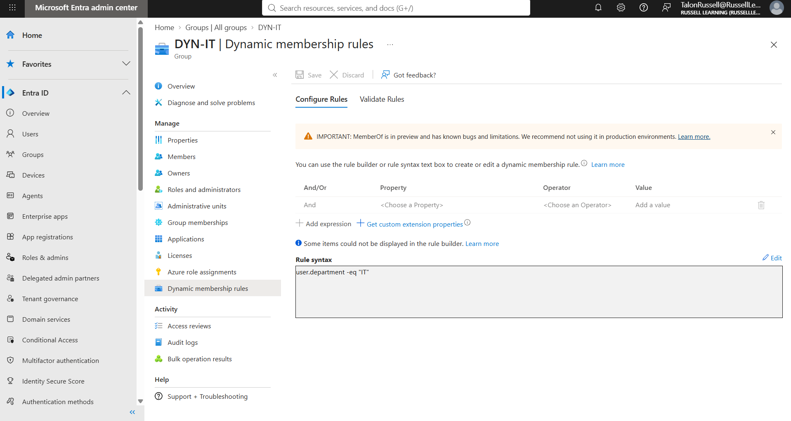

**Screenshot - HR Dynamic Rule**

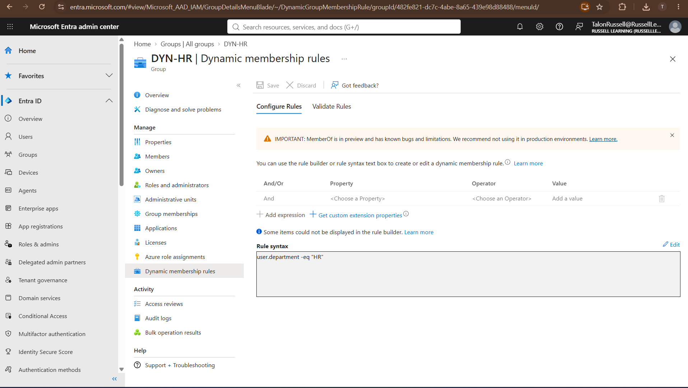

**Screenshot - Finance Dynamic Rule**

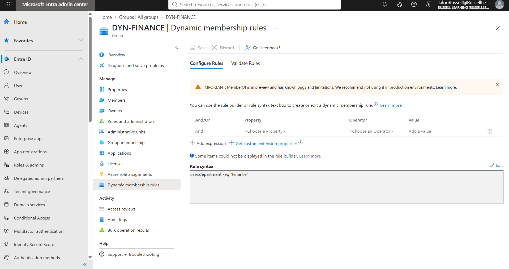

### Step 5 - Verifying Dynamic Group Membership

Once I created the dynamic groups, I checked their memberships to make sure the rules were working.

The groups did not populate immediately, so I had to wait for Entra ID to finish processing the membership rules.

After waiting, I refreshed the groups and confirmed that the users had been added to the correct departments.

The results were:

| Dynamic Group | Number of Members |
|---|---|
| DYN-IT | 3 |
| DYN-HR | 4 |
| DYN-FINANCE | 3 |

These numbers matched the employees I had assigned to each department.

**Screenshot - IT Dynamic Group**

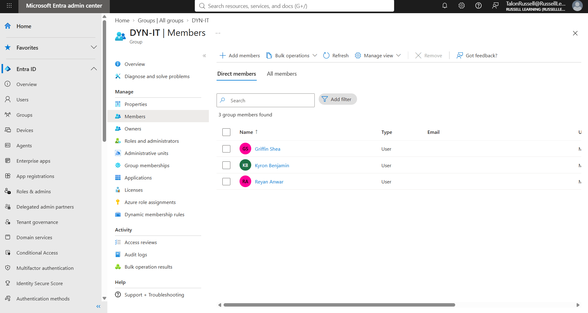

**Screenshot - HR Dynamic Group**

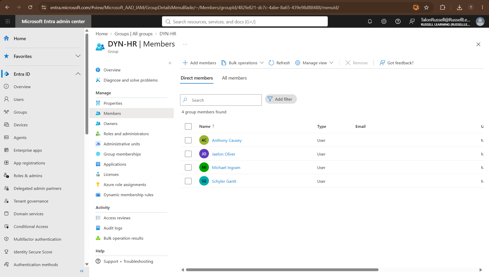

**Screenshot - Finance Dynamic Group**

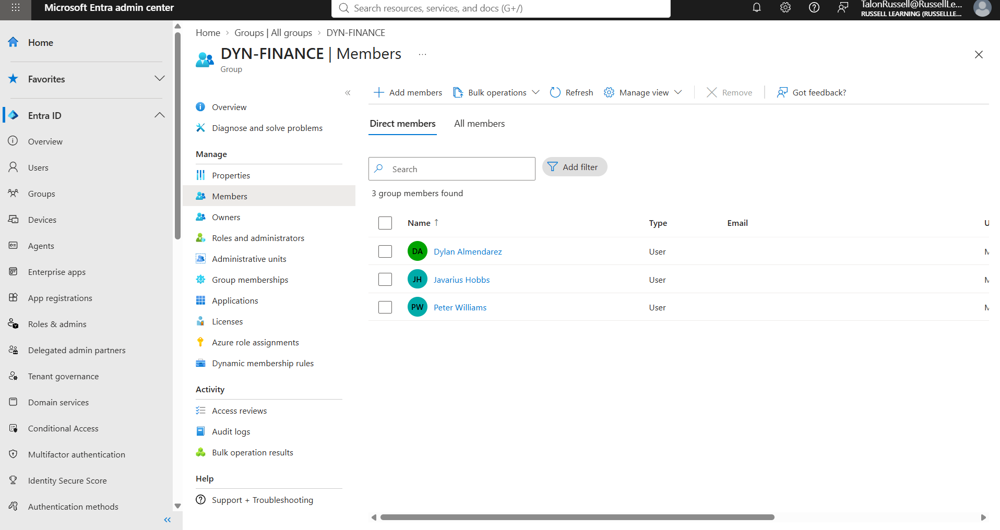

## 6. Validation

After finishing the configurations, I went back through Entra ID to verify that everything was set up correctly.

I checked the created users, assigned security groups, and dynamic group memberships.

### Test Results

| Test | Result |
|---|---|
| Created 10 employee accounts | Pass |
| Configured department attributes | Pass |
| Created 3 assigned security groups | Pass |
| Manually assigned users to groups | Pass |
| Created 3 dynamic security groups | Pass |
| Configured department membership rules | Pass |
| Verified IT dynamic group membership | Pass |
| Verified HR dynamic group membership | Pass |
| Verified Finance dynamic group membership | Pass |
| Tested automatic reassignment after a department change | Not Tested |

All of the configurations I tested worked as expected.

The assigned groups contained the correct employees, and the dynamic groups automatically populated based on the department rules.

I did not test moving a user between departments during this lab.

## 7. Security Considerations

While completing this lab, I also considered how these configurations could affect security in a real organization.

**Least Privilege**

Security groups can help organizations manage access based on an employee's job responsibilities.

Instead of giving every employee the same permissions, access can be assigned to groups based on what each department needs.

**Department Attributes**

Dynamic security groups rely on accurate user information.

If an employee has the wrong department assigned, they could end up in the wrong security group.

This could become a security issue if that group has access to sensitive resources.

**Group Management**

Dynamic groups help reduce manual work, but administrators still need to make sure the membership rules are configured correctly.

**Credential Security**

The CSV file used for bulk provisioning contained initial passwords.

I did not include this file in my GitHub repository because passwords and other sensitive credentials should not be publicly accessible.

## 8. Lessons Learned

This lab helped me become more familiar with user provisioning and group management in Microsoft Entra ID.

One of the main things I learned was how much time bulk provisioning can save compared to creating accounts individually.

I also learned the difference between assigned and dynamic security groups.

With assigned groups, I had to manually select and add each employee. With dynamic groups, Entra ID handled the membership based on the department attributes I configured.

### Challenges I Encountered

**Bulk User Creation**

I initially had issues getting my CSV file to import successfully.

I had to review the CSV template and make sure the required fields were filled out correctly.

After working through the issue, I was able to get all 10 employee accounts created in Entra ID.

**Dynamic Group Membership**

Another issue I encountered was that the dynamic groups did not immediately show their members.

At first, I thought I might have configured the rules incorrectly.

After giving Entra ID more time to process the changes and refreshing the group membership pages, the users appeared in the correct groups.

This helped me understand that some changes in Entra ID take time to process.

### Final Thoughts

Overall, this was a good introductory lab for learning how Microsoft Entra ID handles user provisioning and group management.

I was able to create 10 users, configure their departments, set up assigned security groups, and use dynamic membership rules to automate group assignments.

I also gained experience troubleshooting issues with bulk provisioning and waiting for dynamic membership updates.

For future labs, I want to build on this by working with Role-Based Access Control (RBAC), Conditional Access, and PowerShell automation.

## References

- [Microsoft Entra ID Documentation](https://learn.microsoft.com/en-us/entra/identity/)
- [Bulk Create Users](https://learn.microsoft.com/en-us/entra/identity/users/users-bulk-add)
- [Dynamic Membership Groups](https://learn.microsoft.com/en-us/entra/identity/users/groups-dynamic-membership)
