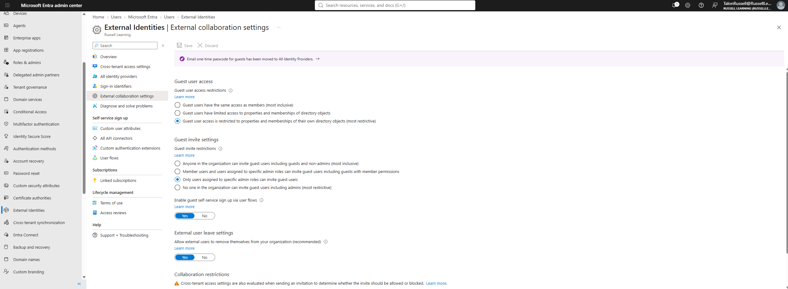
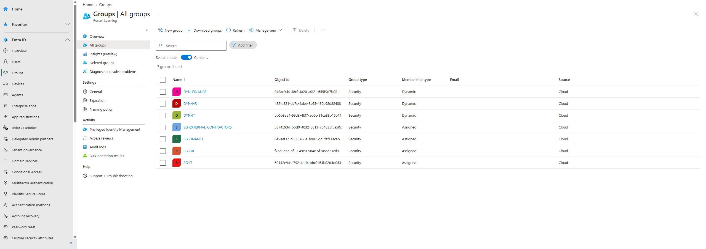
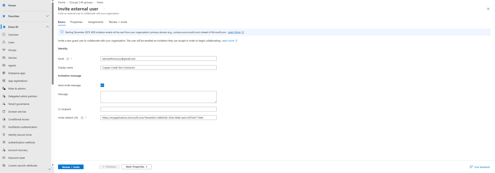
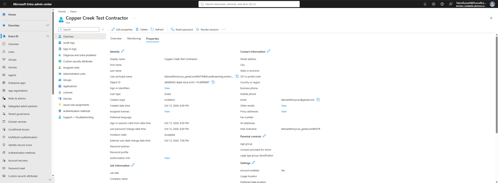
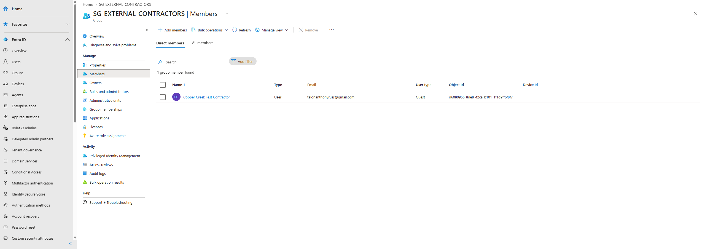
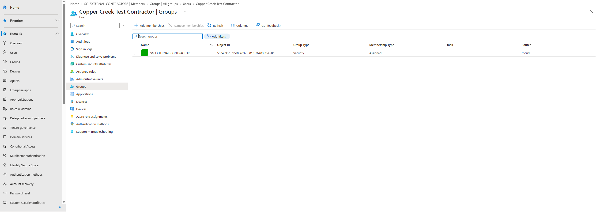
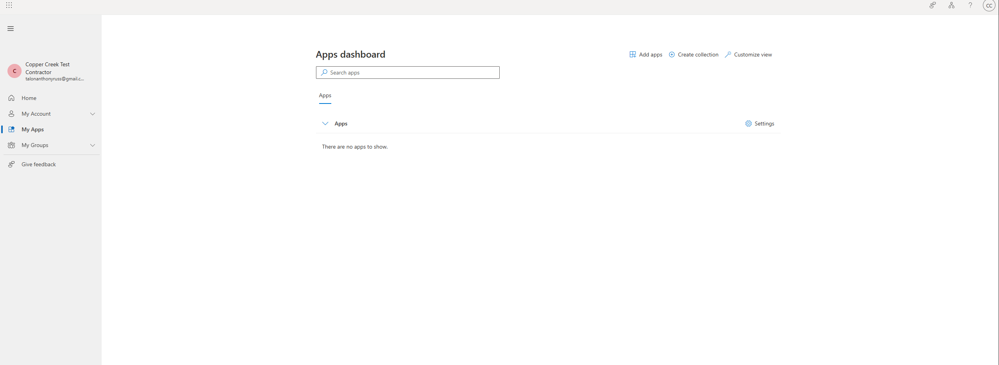
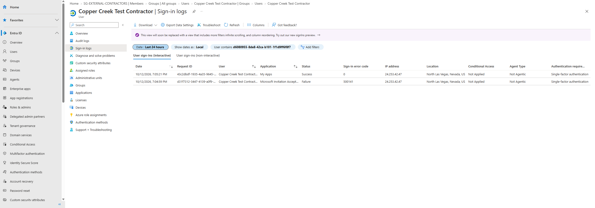

# Lab 02 - Microsoft Entra ID External Identity Management

## 1. Overview

For this lab, I used Microsoft Entra ID to practice managing external users and configuring guest access restrictions in a cloud environment.

The main goal was to invite an external contractor into my Entra ID tenant, configure security settings to restrict guest access, and create a dedicated security group for external users.

I also wanted to understand how organizations can allow contractors to access company resources without giving them the same permissions as internal employees.

This lab builds on my first project, where I created employee accounts and configured security groups for IT, HR, and Finance.

## 2. Business Scenario

For this project, I continued using my fictional company called Copper Creek.

Copper Creek has employees working in three departments: IT, HR, and Finance.

The company now needs to bring in an external contractor to help with a project.

Since the contractor is not a regular employee, I wanted to make sure their account was managed separately from internal users.

Instead of creating another internal employee account, I used Microsoft Entra B2B collaboration to invite the contractor using an external email address.

I also configured guest access restrictions and created a dedicated security group to manage external contractors.

This is useful in a real organization because companies regularly work with vendors, consultants, and contractors who need access to certain resources without receiving unnecessary permissions.

## 3. Objectives

The goals for this lab were to:

- Configure external collaboration settings in Microsoft Entra ID.
- Restrict guest directory visibility.
- Limit which users can invite external accounts.
- Create a dedicated security group for contractors.
- Invite an external user using a personal email address.
- Redeem the guest invitation.
- Verify the account was created as a Guest.
- Confirm the invitation status changed to Accepted.
- Add the contractor to the external security group.
- Verify the contractor was not assigned to internal department groups.
- Test signing in with the external account.
- Review guest authentication activity in Entra ID sign-in logs.
- Gain more hands-on experience managing external identities.

## 4. Technologies Used

- Microsoft Entra ID
- Microsoft Entra Admin Center
- Microsoft Entra External Identities
- Microsoft Entra B2B Collaboration
- Microsoft My Apps Portal
- Security Groups
- External Collaboration Settings
- Guest User Accounts
- Microsoft Entra Sign-in Logs

## 5. Implementation

### Step 1 - Configuring External Collaboration Settings

I started by reviewing the external collaboration settings in Microsoft Entra ID.

I navigated to:

Entra ID > External Identities > External collaboration settings

Under Guest user access, I selected the most restrictive option.

This setting limits guest users to viewing properties and memberships of their own directory objects.

I also changed the guest invitation settings so that only users assigned to specific administrative roles could invite external users.

The purpose of these settings was to reduce unnecessary directory visibility and control who could invite external identities into the organization.

This is important because organizations should not automatically give external users the same directory access as internal employees.

**Screenshot - External Collaboration Settings**

### Step 2 - Creating an External Contractor Security Group

Next, I created a dedicated security group for external contractors.

I navigated to:

Entra ID > Groups > All groups > New group

I used the following configuration:

| Setting | Value |
|---|---|
| Group Name | SG-EXTERNAL-CONTRACTORS |
| Group Type | Security |
| Membership Type | Assigned |
| Description | External contractors with approved project access |

I selected Assigned as the membership type because I wanted to manually control which external users were added to the group.

Unlike the dynamic security groups I created in Lab 01, this group requires an administrator to add or remove members.

This provides more direct control over which contractors are included in the group.

The group could later be used to assign access to specific applications or resources that contractors need for their projects.

**Screenshot - External Contractor Security Group**

### Step 3 - Inviting an External Contractor

After creating the security group, I invited an external user into my Entra ID tenant.

I navigated to:

Entra ID > Users > New user > Invite external user

For this lab, I used a separate personal email account that was not part of my Entra ID tenant.

I configured the invitation using the following information:

| Setting | Value |
|---|---|
| Display Name | Copper Creek Test Contractor |
| Email Address | External personal email |
| Account Type | Guest |
| Invitation Email | Enabled |

After entering the information, I sent the invitation.

Entra ID created an external user account that could be used to collaborate with the organization.

This process is different from creating a normal employee account because the contractor can authenticate using an external identity instead of needing a regular internal employee account.

**Screenshot - External User Invitation**

### Step 4 - Redeeming the Guest Invitation

Once the invitation was sent, I switched to the external email account.

I opened the invitation email and followed the link to accept the invitation.

After completing the sign-in process, I returned to the Entra admin center using my administrator account.

I opened the contractor's user properties to verify that the invitation had been accepted.

The account showed the following information:

| Property | Value |
|---|---|
| Display Name | Copper Creek Test Contractor |
| User Type | Guest |
| Creation Type | Invitation |
| Invitation State | Accepted |
| Account Enabled | Yes |

This confirmed that the contractor account was successfully created and that the invitation had been redeemed.

This is important because sending an invitation does not automatically mean the external user has accepted it.

**Screenshot - Guest Invitation Accepted**

### Step 5 - Assigning the Contractor to a Security Group

Next, I assigned the contractor to the external security group I created earlier.

I navigated to:

Entra ID > Groups > All groups > SG-EXTERNAL-CONTRACTORS > Members

I selected Add members and searched for the Copper Creek Test Contractor account.

After selecting the account, I added it to the group.

I then checked the group membership page to confirm that the contractor appeared as a member.

The group showed one member, and the user type was listed as Guest.

**Screenshot - Contractor Security Group Membership**

### Step 6 - Verifying Contractor Group Restrictions

After assigning the contractor to the security group, I wanted to make sure the account was not a member of any internal department groups.

I navigated to:

Entra ID > Users > Copper Creek Test Contractor > Groups

I reviewed the groups assigned to the contractor account.

The results were:

| Security Group | Membership |
|---|---|
| SG-EXTERNAL-CONTRACTORS | Member |
| SG-IT | Not a member |
| SG-HR | Not a member |
| SG-FINANCE | Not a member |

The account's group membership page only displayed SG-EXTERNAL-CONTRACTORS.

This confirmed that the contractor was separated from the internal department security groups.

Keeping external accounts in dedicated groups makes it easier to manage contractor access and reduces the risk of accidentally assigning permissions intended for employees.

**Screenshot - Guest Group Restrictions**

### Step 7 - Testing the External Contractor Sign-In

After configuring the account and security group membership, I wanted to test the contractor's sign-in experience.

I signed into the Microsoft My Apps portal using the external contractor account.

The sign-in was successful, and I was able to access the Apps dashboard.

However, the dashboard displayed the message:

"There are no apps to show."

This showed that no applications were displayed for the contractor in the My Apps portal at the time of testing.

Since I had not assigned any applications to the contractor during this lab, this was consistent with the environment I configured.

I also learned that successfully signing into the portal does not automatically mean the user has access to internal applications or directory information.

**Screenshot - Contractor My Apps Sign-In**

### Step 8 - Reviewing Guest Sign-In Logs

After testing the contractor account, I wanted to verify that Microsoft Entra ID recorded the authentication activity.

I navigated to:

Entra ID > Users > Copper Creek Test Contractor > Sign-in logs

The logs showed two authentication events.

| Application | Status |
|---|---|
| Microsoft Invitation Acceptance | Failure |
| My Apps | Success |

The Microsoft Invitation Acceptance event showed a failure with error code 500141.

However, the contractor's invitation state was Accepted, and a successful My Apps sign-in was recorded shortly afterward.

This confirmed that the external account was able to authenticate successfully.

I also reviewed the information available in the sign-in logs, including the application, timestamp, authentication status, error code, and Conditional Access result.

This helped me understand how IAM administrators can use authentication logs to troubleshoot sign-in problems and investigate user activity.

**Screenshot - Guest Sign-In Logs**

## 6. Validation

After finishing the configurations, I went back through Microsoft Entra ID to verify that everything was set up correctly.

I checked the external collaboration settings, contractor security group, guest account properties, and group memberships.

I also tested the external account's sign-in experience and reviewed its authentication logs.

### Test Results

| Test | Result |
|---|---|
| Configured restrictive guest directory visibility | Pass |
| Restricted guest invitation permissions | Pass |
| Created external contractor security group | Pass |
| Configured assigned security group membership | Pass |
| Invited external contractor | Pass |
| Verified guest account creation | Pass |
| Verified user type was Guest | Pass |
| Verified invitation status was Accepted | Pass |
| Added contractor to external security group | Pass |
| Verified contractor was not in internal groups | Pass |
| Successfully signed into Microsoft My Apps | Pass |
| Verified successful authentication in sign-in logs | Pass |
| Reviewed failed invitation acceptance event | Pass |
| Verified sign-in activity was recorded | Pass |

All of the configurations I verified worked as expected.

The contractor was successfully invited into the tenant, accepted the invitation, and was assigned to the correct security group.

I also confirmed that the contractor was not assigned to the internal IT, HR, or Finance groups.

The external account successfully signed into Microsoft My Apps, and the successful authentication was recorded in Entra ID sign-in logs.

I did not independently test whether the contractor could view other directory objects or access a protected enterprise application.

## 7. Security Considerations

While completing this lab, I considered how external identities could introduce security risks if they are not properly managed.

### Least Privilege

External users should only receive access to the resources required for their work.

Just because a contractor has been invited into the tenant does not mean they should have access to internal applications or sensitive information.

Using dedicated security groups helps administrators organize users and assign permissions based on business requirements.

### Guest Directory Visibility

Guest accounts should not automatically have the same directory visibility as internal employees.

I configured the most restrictive guest directory visibility option in Entra ID.

This setting is intended to reduce the amount of directory information external users can discover.

### Guest Invitation Permissions

Allowing every employee to invite external users can make it harder to control who has access to an organization.

I restricted guest invitations to users assigned to specific administrative roles.

This provides additional control over external identity onboarding.

### Security Group Separation

I created a dedicated security group for external contractors instead of placing them in the same groups as internal employees.

This makes it easier to identify external users and manage their access separately.

It also reduces the risk of accidentally granting permissions through internal department groups.

### Authentication Monitoring

Reviewing sign-in logs is important for identifying successful and failed authentication attempts.

During this lab, I found both a failed invitation acceptance event and a successful My Apps sign-in.

This demonstrated how administrators can use Entra ID logs to investigate authentication activity.

### External Account Lifecycle

Organizations should regularly review external accounts to determine whether they are still needed.

When a contractor finishes a project, their access should be removed.

Otherwise, inactive guest accounts could remain in the environment longer than necessary.

### Credential and Invitation Security

Guest invitation links, passwords, and authentication tokens should not be uploaded to public repositories.

For this lab, I documented the configuration process without publishing invitation redemption links or authentication credentials.

## 8. Lessons Learned

This lab helped me become more familiar with external identity management in Microsoft Entra ID.

One of the main things I learned was how Microsoft Entra B2B collaboration allows organizations to invite external users without creating normal internal employee accounts.

I also learned how external collaboration settings can be used to restrict guest directory visibility and control who can invite external users.

Another important part of this lab was understanding how security groups can separate contractors from internal employees.

By creating a dedicated contractor group, I could manage external membership without mixing those accounts with the IT, HR, or Finance groups.

I also gained experience reviewing sign-in logs to verify authentication activity.

### Challenges I Encountered

**Understanding the Guest Sign-In Experience**

After accepting the invitation, I was redirected to the Microsoft My Apps portal.

At first, I was not sure whether the invitation had worked correctly because the dashboard did not display any applications.

After reviewing the page and checking the guest account properties, I confirmed that the invitation status was Accepted.

This helped me understand the difference between successfully authenticating and actually having access to applications.

**Reviewing the Failed Invitation Acceptance Event**

While reviewing the sign-in logs, I noticed that the Microsoft Invitation Acceptance event showed a failure.

The event included error code 500141.

However, the contractor's invitation state was Accepted, and the logs showed a successful My Apps sign-in shortly afterward.

This taught me that authentication logs need to be reviewed alongside other account information before determining whether a user can successfully access a service.

**Verifying Guest Restrictions**

Another thing I learned was that configuring a security setting does not automatically prove that the restriction works from the end user's perspective.

I verified the guest collaboration settings through the administrator portal, but I did not independently test directory visibility using the external account.

This helped me understand the importance of separating configuration verification from actual access testing when documenting IAM work.

### Final Thoughts

Overall, this lab was a good introduction to managing external identities in Microsoft Entra ID.

I was able to configure guest collaboration settings, create a dedicated contractor security group, invite an external user, and verify that the invitation was accepted.

I also confirmed that the contractor was only assigned to the external security group and was not included in the internal department groups.

Finally, I successfully signed in using the contractor account and reviewed the authentication activity through Entra ID sign-in logs.

This lab built on the user and group management concepts from Lab 01 and introduced another important responsibility of an IAM administrator: managing identities that exist outside the organization.

For future labs, I want to build on this by working with Role-Based Access Control (RBAC), Conditional Access, and identity automation using PowerShell and Microsoft Graph.

## References

- [Microsoft Entra External Identities Documentation](https://learn.microsoft.com/en-us/entra/external-id/)
- [Configure External Collaboration Settings](https://learn.microsoft.com/en-us/entra/external-id/external-collaboration-settings-configure)
- [Invite B2B Collaboration Users](https://learn.microsoft.com/en-us/entra/external-id/add-users-administrator)
- [Microsoft Entra Group Management](https://learn.microsoft.com/en-us/entra/fundamentals/how-to-manage-groups)
- [Microsoft Entra Sign-In Logs](https://learn.microsoft.com/en-us/entra/identity/monitoring-health/concept-sign-ins)
