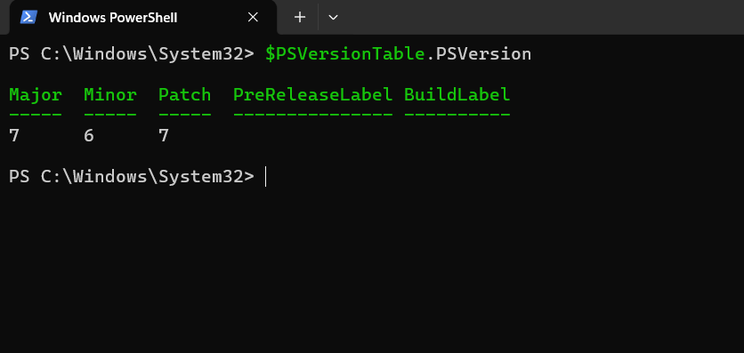
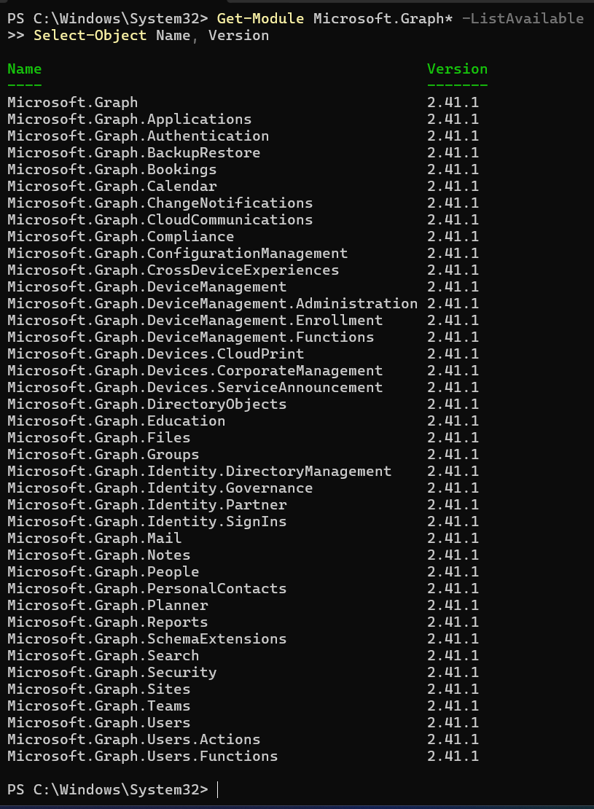
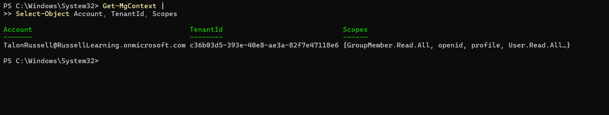
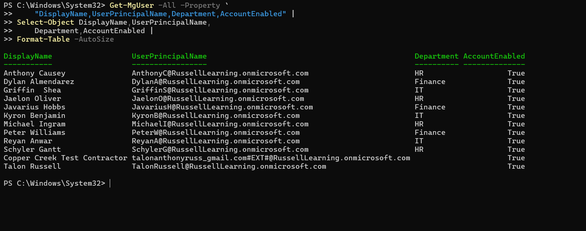
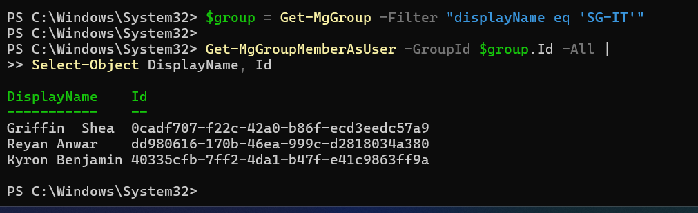
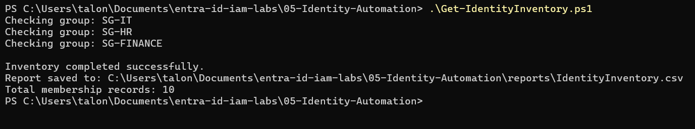
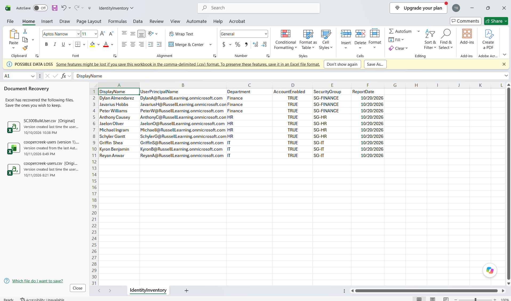
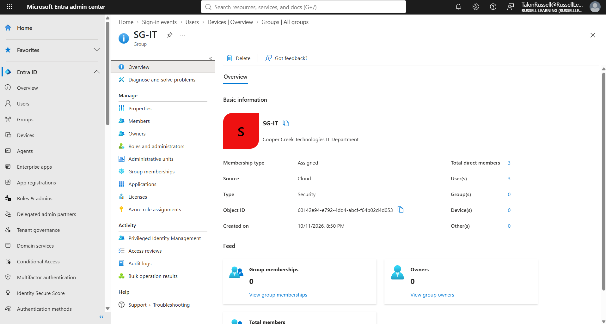
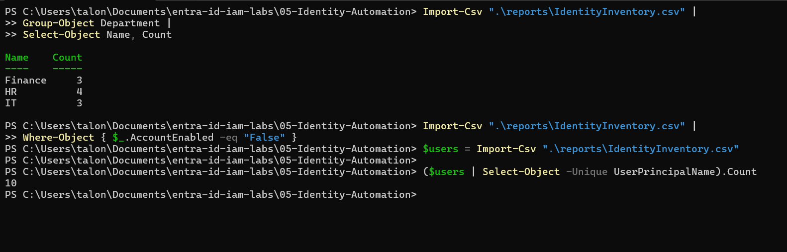

# Lab 05 — Microsoft Graph PowerShell Identity Automation

## Overview

In this lab, I used Microsoft Graph PowerShell to automate the process of collecting employee information and security group memberships from Microsoft Entra ID.

The goal was to create a reusable PowerShell script that could generate an identity inventory report instead of manually reviewing each employee account in the Entra admin center.

## Business Scenario

Copper Creek Technologies needs to review employee accounts and security group memberships across its IT, HR, and Finance departments.

As an IAM analyst, I was tasked with creating a PowerShell script to collect employee information, identify security group memberships, and export the results into a CSV report for review.

## Technologies Used

- Microsoft Entra ID
- Microsoft Graph PowerShell SDK
- PowerShell 7
- Microsoft Excel

## Objectives

- Connect to Microsoft Entra ID using Microsoft Graph PowerShell.
- Retrieve employee account information and department attributes.
- Identify security group memberships.
- Automate identity inventory collection using PowerShell.
- Export employee information into a CSV report.
- Validate the report against Microsoft Entra ID.
- Analyze account status and department membership.

---

## Implementation

### Step 1 — Install PowerShell 7

Installed PowerShell 7 to use for Microsoft Graph PowerShell automation.

Verified the installation by running:

```powershell
$PSVersionTable.PSVersion
```



### Step 2 — Install Microsoft Graph Modules

Installed the Microsoft Graph PowerShell modules needed to connect to Entra ID and retrieve user and group information.

```powershell
Install-Module Microsoft.Graph.Authentication -Scope CurrentUser
Install-Module Microsoft.Graph.Users -Scope CurrentUser
Install-Module Microsoft.Graph.Groups -Scope CurrentUser
```

Verified the installed modules:

```powershell
Get-Module Microsoft.Graph* -ListAvailable |
Select-Object Name, Version
```



### Step 3 — Connect to Microsoft Graph

Connected to my Microsoft Entra ID lab tenant using Microsoft Graph PowerShell.

Used the following read-only permissions:

- User.Read.All
- Group.Read.All
- GroupMember.Read.All

```powershell
Connect-MgGraph -Scopes @(
    "User.Read.All",
    "Group.Read.All",
    "GroupMember.Read.All"
) -NoWelcome
```

Verified the connection:

```powershell
Get-MgContext |
Select-Object Account, TenantId, Scopes
```



### Step 4 — Query Employee Accounts

Used Microsoft Graph PowerShell to retrieve employee account information from Microsoft Entra ID.

The query retrieved display names, user principal names, departments, and account status.

```powershell
Get-MgUser -All -Property `
    "DisplayName,UserPrincipalName,Department,AccountEnabled" |
Select-Object DisplayName,UserPrincipalName,
    Department,AccountEnabled |
Format-Table -AutoSize
```

Verified that the fictional employee accounts created in my earlier labs appeared in the results.



### Step 5 — Verify Security Groups

Queried the security groups created in my earlier Entra ID labs.

The groups included:

- SG-IT
- SG-HR
- SG-FINANCE

Retrieved the available security groups:

```powershell
Get-MgGroup -All |
Select-Object DisplayName, Id |
Format-Table -AutoSize
```

Also queried the members of the SG-IT security group:

```powershell
$group = Get-MgGroup -Filter "displayName eq 'SG-IT'"

Get-MgGroupMemberAsUser -GroupId $group.Id -All |
Select-Object DisplayName, Id
```



### Step 6 — Create the Project Folders

Created a local project directory to organize the PowerShell script, reports, and screenshots.

The folder structure was:

```text
05-Identity-Automation/
├── Get-IdentityInventory.ps1
├── README.md
├── reports/
└── screenshots/
```

The reports folder was used to store generated CSV reports, while the screenshots folder was used to document the lab.

### Step 7 — Create the Identity Inventory Script

Created a PowerShell script named `Get-IdentityInventory.ps1` to automate the identity inventory process.

The script performs the following tasks:

1. Verifies the Microsoft Graph connection.
2. Searches for the selected security groups.
3. Retrieves direct user members from each group.
4. Collects employee identity information.
5. Creates an inventory of employee and group membership data.
6. Exports the results into a CSV report.

The report includes:

- DisplayName
- UserPrincipalName
- Department
- AccountEnabled
- SecurityGroup
- ReportDate

The script uses read-only Microsoft Graph queries and does not modify employee accounts or security groups.

**PowerShell Script:**

[View Get-IdentityInventory.ps1](Get-IdentityInventory.ps1)

### Step 8 — Navigate to the Project Directory

Opened PowerShell 7 and navigated to the Lab 05 project folder.

```powershell
cd "$HOME\Documents\entra-id-iam-labs\05-Identity-Automation"
```

Verified that the PowerShell script and project folders were present:

```powershell
Get-ChildItem
```

### Step 9 — Execute the PowerShell Script

Executed the identity inventory script to automatically collect employee information and security group memberships.

```powershell
.\Get-IdentityInventory.ps1
```

The script successfully queried all three security groups and generated an identity inventory containing 10 membership records.

The results were exported to:

`reports/IdentityInventory.csv`



### Step 10 — Open and Review the CSV Report

Opened the generated CSV report in Microsoft Excel to review the collected employee information.

The report contained six columns:

- DisplayName
- UserPrincipalName
- Department
- AccountEnabled
- SecurityGroup
- ReportDate

The report contained 10 membership records across the IT, HR, and Finance departments.



### Step 11 — Validate Group Membership in Microsoft Entra ID

Validated the accuracy of the exported report by comparing the CSV results against Microsoft Entra ID.

Navigated to:

**Microsoft Entra admin center > Entra ID > Groups > All groups > SG-IT > Members**

The SG-IT security group contained three employees, matching the three membership records shown in the CSV report.

I compared the membership information to confirm that the PowerShell script retrieved accurate results.



### Step 12 — Analyze the CSV Report Using PowerShell

Used PowerShell to analyze the generated identity inventory report.

**Count employees by department:**

```powershell
Import-Csv ".\reports\IdentityInventory.csv" |
Group-Object Department |
Select-Object Name, Count
```

The results were:

| Department | Employees |
|---|---|
| IT | 3 |
| HR | 4 |
| Finance | 3 |
| **Total** | **10** |

**Check for disabled accounts:**

```powershell
Import-Csv ".\reports\IdentityInventory.csv" |
Where-Object { $_.AccountEnabled -eq "False" }
```

The query returned no results because all 10 employee accounts in the report were enabled.

**Count unique employee accounts:**

```powershell
$users = Import-Csv ".\reports\IdentityInventory.csv"

($users | Select-Object -Unique UserPrincipalName).Count
```

The result confirmed that the report contained 10 unique employee accounts.



---

## Results

Successfully created and executed a PowerShell script to automate identity inventory reporting in Microsoft Entra ID.

The script collected employee information and direct security group memberships across three departments.

**Final Results:**

- 10 unique employee accounts identified.
- 3 security groups successfully queried.
- 3 IT employees.
- 4 HR employees.
- 3 Finance employees.
- 0 disabled accounts identified in the report.
- CSV report generated successfully.
- SG-IT membership validated against Microsoft Entra ID.

## Lessons Learned

This lab helped me understand how Microsoft Graph PowerShell can be used to automate identity administration and reporting tasks.

I learned how to connect to Microsoft Entra ID, retrieve employee information, query security group memberships, and generate CSV reports using PowerShell.

I also gained experience validating automated reports against Microsoft Entra ID and using PowerShell to analyze identity data.

This showed me how automation can reduce manual work when performing IAM inventory and access auditing tasks.

## Security Considerations

The PowerShell script uses read-only Microsoft Graph permissions and does not modify or delete user accounts or security groups.

All testing was performed using fictional employee accounts in a personal Microsoft Entra ID lab environment.

The script only inventories direct membership in the three selected security groups and does not represent a full tenant-wide access review.

## Future Improvements

Some improvements I could make to this project include:

- Identifying disabled accounts that still belong to security groups.
- Detecting mismatches between employee departments and security group assignments.
- Automatically generating inventory reports on a schedule.
- Adding error logging and exception handling.
- Expanding reporting to include privileged role assignments.
