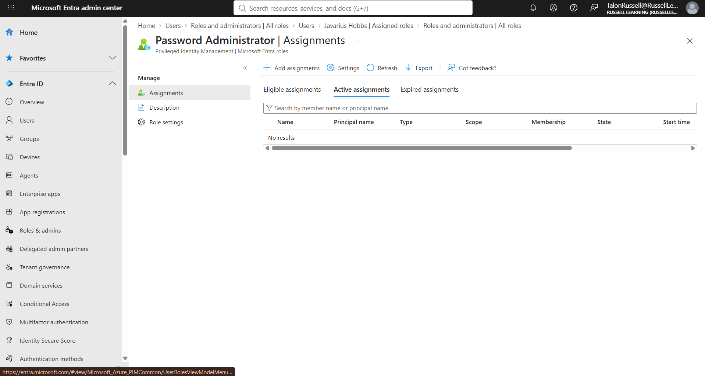
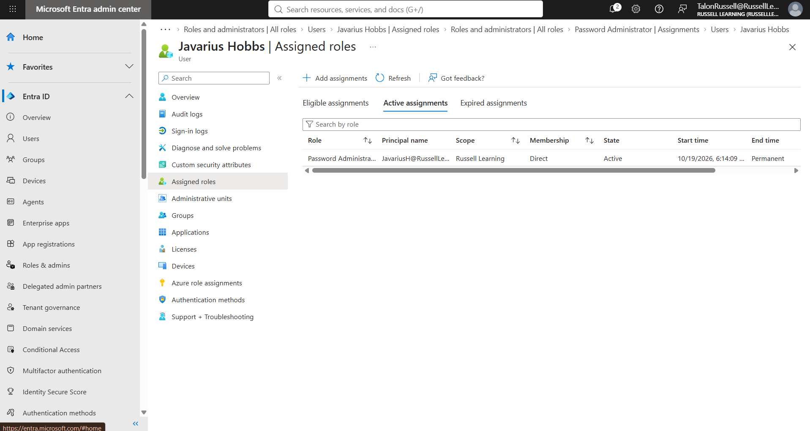
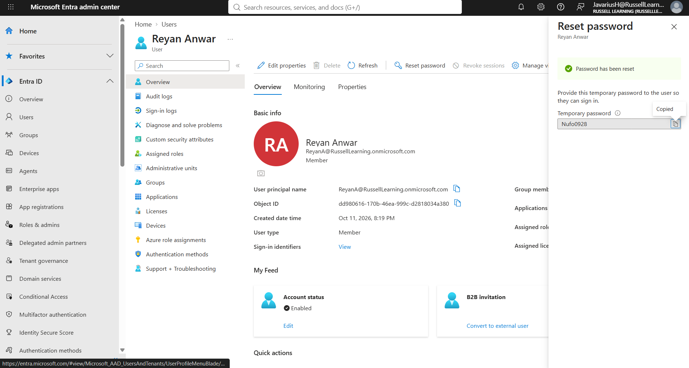
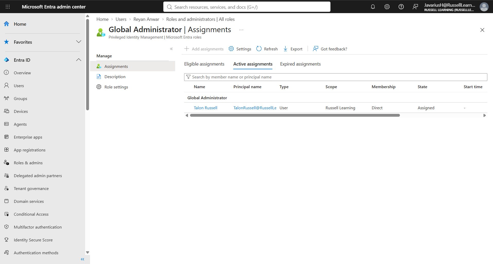
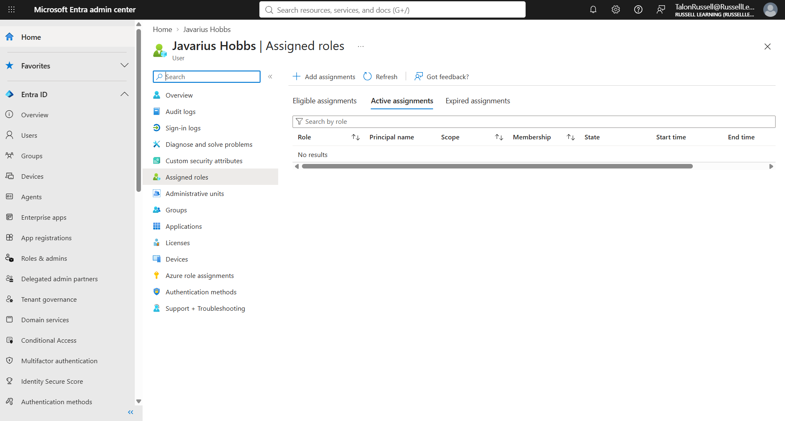
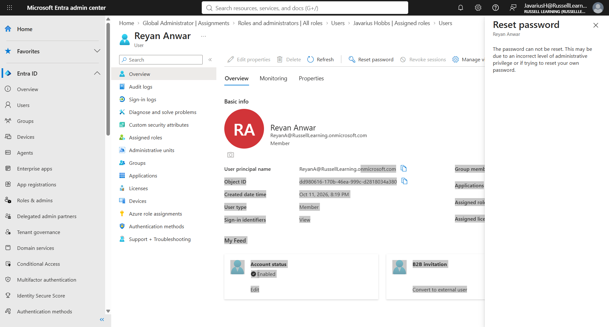
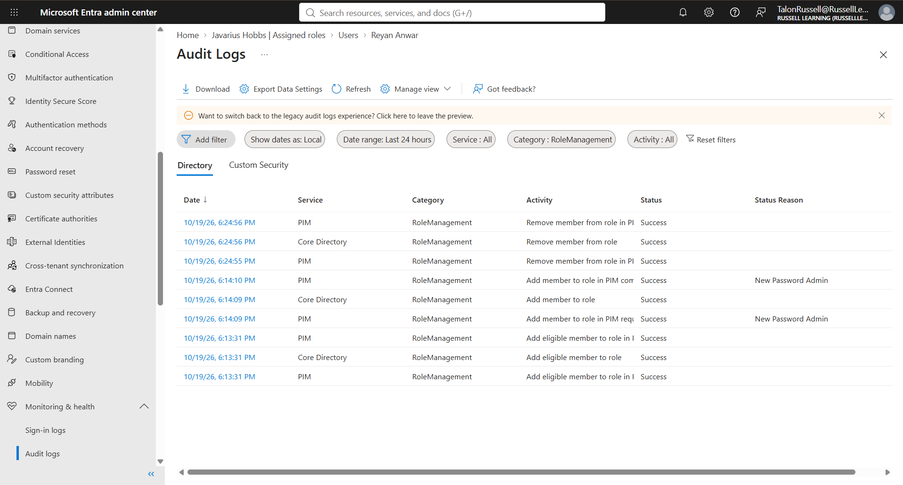

# Lab 03 — Role-Based Access Control (RBAC)

## Overview

In this lab, I configured Role-Based Access Control (RBAC) in Microsoft Entra ID to manage administrative permissions for a fictional company called Copper Creek.

The goal was to allow an IT helpdesk employee to reset user passwords without granting unnecessary administrative privileges.

I assigned the Password Administrator role, tested the employee's permissions, removed the role, and reviewed audit logs to verify administrative activity.

## Business Scenario

Copper Creek has an IT helpdesk employee who needs to assist users with password resets.

The employee requires permission to reset passwords for standard users but should not have unrestricted administrative access to the Microsoft Entra ID environment.

As the IAM administrator, I was responsible for assigning the appropriate role, validating the employee's permissions, and removing administrative access when it was no longer required.

This scenario demonstrates how Copper Creek can follow the principle of least privilege when managing administrative access.

## Objectives

- Identify the appropriate administrative role for helpdesk responsibilities.
- Assign the Password Administrator role to a Copper Creek helpdesk employee.
- Verify that the role was successfully assigned.
- Test password-reset permissions on a standard user account.
- Verify that privileged administrative functions remain restricted.
- Remove the assigned administrative role.
- Confirm that elevated permissions were revoked.
- Review audit logs for administrative activity.

## Technologies Used

- Microsoft Entra ID
- Microsoft Entra Admin Center
- Role-Based Access Control (RBAC)
- Microsoft Entra Audit Logs

---

## Implementation

### Step 1 — Identify the Administrative Role

I signed in to the Microsoft Entra admin center using my administrator account.

I navigated to Entra ID > Roles & admins > Roles & administrators and searched for the built-in Password Administrator role.

I selected this role because it provides delegated password-management permissions without granting Global Administrator access.

This follows the principle of least privilege by limiting administrative access to the permissions required for the employee's responsibilities.

### Step 2 — Assign the Password Administrator Role

I selected the Password Administrator role and assigned it to a fictional Copper Creek helpdesk employee.

After completing the assignment, I navigated to the employee's account and opened the Assigned roles section.

I verified that Password Administrator appeared as an active administrative role and confirmed that the employee did not have Global Administrator permissions.

### Step 3 — Test Delegated Password Reset Permissions

To test the assigned permissions, I opened a separate browser session and signed in using the helpdesk employee's account.

I navigated to another fictional Copper Creek employee's account and performed a password reset.

The password reset completed successfully, confirming that the Password Administrator role allowed the helpdesk employee to perform authorized password-management tasks.

### Step 4 — Verify Restricted Administrative Access

After testing the password-reset functionality, I checked whether the helpdesk employee could perform more privileged administrative actions.

I navigated to the Roles & administrators section and reviewed access to the Global Administrator role assignments.

I confirmed that the helpdesk employee could not assign Global Administrator privileges or manage privileged role assignments.

This demonstrated that the employee's administrative permissions were limited to their assigned responsibilities.

### Step 5 — Remove the Administrative Role

After completing the permission tests, I signed back in using my administrator account.

I navigated to the helpdesk employee's Assigned roles page and removed the Password Administrator assignment.

I refreshed the page and verified that the administrative role no longer appeared on the employee's account.

This simulated removing elevated permissions when a Copper Creek employee no longer requires administrative access.

### Step 6 — Verify Access Revocation

To verify that the permissions were removed, I signed out of the helpdesk employee's account and started a new browser session.

I signed back in and attempted to access the password-reset functionality for another standard user.

The employee was no longer able to perform delegated password resets, confirming that the administrative permissions had been revoked.

### Step 7 — Review Microsoft Entra Audit Logs

I returned to my administrator account and navigated to the Microsoft Entra audit logs.

I reviewed the RoleManagement and UserManagement categories to identify events associated with administrative role changes and password resets.

The logs showed successful role-management and password-reset operations.

This demonstrated how Microsoft Entra ID records administrative activity for auditing and accountability.

---

## Validation Results

The following table summarizes the results of the tests performed during the lab.

| Test | Expected Result | Actual Result |
|---|---|---|
| Assign Password Administrator | Role assigned successfully | Passed |
| Verify role assignment | Role appears on employee account | Passed |
| Reset standard user's password | Password reset succeeds | Passed |
| Attempt privileged role assignment | Access restricted | Passed |
| Remove Password Administrator | Role removed successfully | Passed |
| Test password reset after removal | Delegated access denied | Passed |
| Review audit logs | Administrative events recorded | Passed |

## Security Concepts Demonstrated

### Role-Based Access Control (RBAC)

Administrative permissions were assigned using a built-in Microsoft Entra ID role instead of granting unrestricted access.

### Principle of Least Privilege

The Copper Creek helpdesk employee received only the administrative permissions required to perform password-reset responsibilities.

### Delegated Administration

Password-management responsibilities were delegated to a helpdesk employee without requiring Global Administrator privileges.

### Access Revocation

The administrative role was removed after testing to demonstrate how elevated permissions can be revoked when they are no longer required.

### Auditing and Accountability

Microsoft Entra audit logs were reviewed to identify role-management operations and password-reset activity.

---

## Lessons Learned

This lab helped me better understand how Microsoft Entra ID uses RBAC to control administrative permissions.

I learned how to assign administrative roles, verify permissions, and test whether users can perform the tasks associated with their assigned roles.

I also gained experience removing administrative privileges and reviewing audit logs to confirm changes made within the environment.

One of the main things I learned was the importance of testing permissions rather than assuming a role assignment works as expected.

## Conclusion

This lab demonstrated how Copper Creek can use RBAC to securely delegate administrative responsibilities in Microsoft Entra ID.

By assigning the Password Administrator role, testing delegated access, removing privileges, and reviewing audit logs, I gained practical experience with administrative access management and least-privilege security.

These tasks are relevant to IAM analysts and administrators who are responsible for maintaining secure access to enterprise identity systems.
